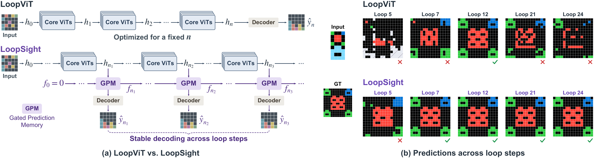

<div align="center">
<h3>LoopSight: <br>
Looped Vision Transformers with Gated Prediction Memory</h3>

Zhaozhi Wang<sup>1</sup>, Mingrui Wu<sup>2</sup>, Jiaming Zhao<sup>2</sup>, An-Syu Li<sup>1</sup>, Jun Luo<sup>1</sup>

<sup>1</sup> Nanyang Technological University<br>
<sup>2</sup> University of Chinese Academy of Sciences

</div>

## Abstract

Looped vision transformers extend computation for visual reasoning by repeatedly applying a shared Transformer core. A challenge is to preserve useful prediction information across loop iterations while allowing the computation state to evolve. In this paper we introduce LoopSight, a looped vision transformer that uses Gated Prediction Memory (GPM) to maintain a persistent prediction state for readout, separate from the core's evolving computation state. At each iteration, a cross-attention gate uses the core's candidate features, the previous prediction state, and the current task state to control writes at the patch and channel level. The model decodes its prediction from the updated memory. We condition the shared core on the current iteration using asymptotic loop encoding and train the model by supervising its prediction at loop counts sampled from a truncated Gaussian distribution. LoopSight outperforms LoopViT across three model scales on ARC-AGI-1 and ARC-AGI-2. On ARC-AGI-1, LoopSight-Small achieves 67.4% pass@2, a gain of 6.6 percentage points over LoopViT-Small with comparable parameter counts and FLOPs. LoopSight also outperforms LoopViT on Visual Sudoku and ImageNet classification. Further analyses on ARC-AGI-1 show that LoopSight preserves more already-correct predictions and maintains more stable readout features as its computation state continues to evolve.

<div align="center">
  
</div>

## Installation

Use Python 3.11 or newer. Run the commands below from the repository root.

```bash
python -m pip install -r requirements.txt
```

## Data preparation

Follow `docs/data_preparation.md` for ARC-AGI-1, ARC-AGI-2, and RE-ARC.
The image benchmark instructions are in their respective benchmark directories.
Dataset, checkpoint, and output locations in the public commands are relative
to the repository root.

Prepare datasets separately before training. Dataset files and model weights
are excluded from this repository.

## ARC offline training with EMA

Each scale has a launcher. Training uses effective batch 256 (microbatch 8, accumulation 32),
100 epochs, 10 warmup epochs, AdamW, cosine decay,
and gradient clipping at 1.0. One Gaussian loop depth is sampled per optimizer
update and shared across accumulated microbatches.
The supervised objective is final-output pixel cross-entropy.

```bash
bash scripts/train_small.sh
bash scripts/train_medium.sh
bash scripts/train_large.sh
```

Trainer options follow the script name.

```bash
bash scripts/train_small.sh \
  --batch-size 2 --accumulation-steps 4
```

### Multi-GPU training

Launch one process per visible GPU with `torchrun`. The following four-process
examples keep the effective batch at 256 for each scale.

```bash
torchrun --standalone --nproc_per_node=4 train_loopsight_arc.py \
  --scale small --batch-size 8 --accumulation-steps 8

torchrun --standalone --nproc_per_node=4 train_loopsight_arc.py \
  --scale medium --batch-size 8 --accumulation-steps 8

torchrun --standalone --nproc_per_node=4 train_loopsight_arc.py \
  --scale large --batch-size 8 --accumulation-steps 8
```

Set `--nproc_per_node` to the number of GPUs to use. `--batch-size` is the
microbatch per process; effective batch is `processes × batch-size ×
accumulation-steps`. Each process uses its local device, gradients are
synchronized with DistributedDataParallel, and the sampled loop count is shared
across processes. The primary process writes checkpoints, including final EMA.

EMA is enabled at decay 0.9999. Each run writes raw `final.pt`, resumable
`last.pt`, raw validation-best `best.pt`, EMA validation-best `best_ema.pt`,
and final-step `ema_final.pt` under `outputs/loopsight_SCALE/offline/`.
Validation evaluates raw and EMA parameters. The final
EMA export contains the last training epoch's average. Resume using the same
process count and batch settings. For a distributed run, append
`--resume-checkpoint outputs/loopsight_SCALE/offline/last.pt` to its original
`torchrun` command. For an ordinary run:

```bash
bash scripts/train_medium.sh \
  --resume-checkpoint outputs/loopsight_medium/offline/last.pt
```

## ARC test-time training with EMA

The TTT launchers initialize from the corresponding final offline EMA, replace
the task embedding vocabulary, and optimize two independent attempts per task.
All scales use fixed loop counts during adaptation and prediction, 100 epochs,
batch 8, learning rate 3e-4, 10 warmup epochs, and TTT EMA decay 0.998. Each
attempt produces predictions for raw and final EMA parameters using the same
inference augmentation draws. Ten inference augmentations are used per attempt.

```bash
bash scripts/ttt_small.sh --dataset arc1
bash scripts/ttt_medium.sh --dataset arc1
bash scripts/ttt_large.sh --dataset arc1

bash scripts/ttt_small.sh --dataset arc2
bash scripts/ttt_medium.sh --dataset arc2
bash scripts/ttt_large.sh --dataset arc2
```

### Parallel TTT across GPUs

TTT assigns different evaluation tasks to different processes. Each task keeps
its own adaptation attempts, optimizer, task embeddings, and EMA exports.

```bash
torchrun --standalone --nproc_per_node=4 ttt_loopsight_arc.py \
  --scale small --dataset arc1
```

Use `--scale medium` or `--scale large` for the other models, and `--dataset
arc2` for ARC-AGI-2. The selected task list is divided automatically; predictions
from all processes are written to the same task-organized output directory.

Prepare TTT augmentations for the selected dataset as described in the data guide. Select
tasks or supply a checkpoint explicitly for a smaller run.

```bash
bash scripts/ttt_small.sh --dataset arc1 \
  --checkpoint outputs/loopsight_small/offline/ema_final.pt --tasks 00576224
```

TTT runs one task at a time on the selected device. Results are grouped under
`outputs/loopsight_SCALE/ttt/DATASET/`. The `checkpoints/` and
`checkpoints_ema/` folders contain both adaptation attempts for each task.
Each completed EMA attempt also exposes an `attempt_N/ema_final.pt` export.
Epoch checkpoints in `resume/` allow interrupted adaptations to continue.

Aggregate the two EMA prediction sets to compute task-macro Pass@1 and Pass@2.

```bash
python evaluate_arc_ttt.py \
  --data-root raw_data/ARC-AGI \
  --output-root outputs/loopsight_small/ttt/arc1/predictions_ema_attempt_0 \
  --output-root outputs/loopsight_small/ttt/arc1/predictions_ema_attempt_1 \
  --json-output outputs/loopsight_small/ttt/arc1/ema_evaluation.json
```

### Prediction visualization

Export a test example's input, target (when available), and majority-vote prediction
as one PNG. Select a different test example with `--example-index`.

```bash
python visualize_arc.py \
  --task raw_data/ARC-AGI/data/evaluation/00576224.json \
  --predictions outputs/loopsight_small/ttt/arc1/predictions_ema_attempt_0/00576224_predictions.json \
  --output outputs/visualizations/00576224.png
```

## Optimized CUDA execution

LoopSight offers opt-in fusion on NVIDIA Ampere and newer CUDA GPUs with
Triton installed. The training path compiles the normalization and
conditioning operations with autograd and supports sampled loop depths.
The FP32 inference path also fuses prediction-memory updates and can
schedule them alongside the backbone on a second CUDA stream.

Use `--optimize` with either ARC launcher. CUDA offline training and TTT
adaptation use their regular FP16 AMP and gradient scaling by default.
Add `--no-amp` for FP32 training. Evaluation and TTT prediction keep
their usual FP32 execution.

```bash
bash scripts/train_small.sh --optimize
bash scripts/ttt_small.sh --dataset arc1 --optimize
```

To opt in when loading a checkpoint for inference:

```python
import torch
from loopsight import load_checkpoint

model, _ = load_checkpoint("outputs/loopsight_small/offline/ema_final.pt", device="cuda")
model.enable_optimization(inference=True, training=False)
with torch.inference_mode():
    logits, metadata = model(pixels, task_ids)
```

Here `pixels` and `task_ids` are CUDA integer tensors. Small and Medium
default to two streams, and Large uses a single stream. Set
`overlap_memory=False` to select single-stream inference. CPU and
inference under autocast or with intermediate readouts use standard
execution. The same model weights and checkpoint format work with either
path.

## Other benchmarks

Data preparation, training, and evaluation instructions are provided in:

- `loopsight_benchmarks/visual_sudoku/README.md`
- `loopsight_benchmarks/imagenet100/README.md`

## Acknowledgements

This codebase builds on [LoopViT](https://github.com/WenjieShu/LoopViT) and
[VARC](https://github.com/kyegomez/VARC). We thank their authors for sharing
the implementations that supported this work.

## Citation
```
@misc{loopsight,
    title         = {{LoopSight: Looped Vision Transformers with Gated Prediction Memory}},
    author        = {Zhaozhi Wang and Mingrui Wu and Jiaming Zhao and An-Syu Li and Jun Luo},
    year          = {2026},
    eprint        = {2611.28575},
    archivePrefix = {arXiv},
    primaryClass  = {cs.CV},
    url           = {https://arxiv.org/abs/2611.28575},
}
```
